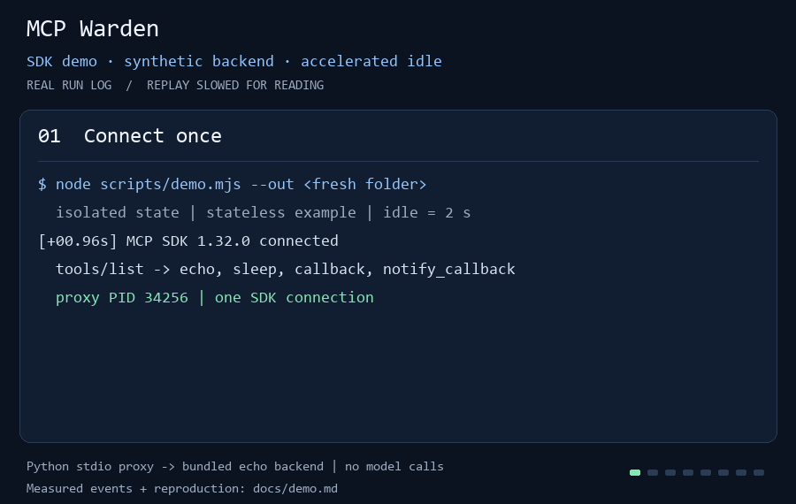

# MCP Warden

[English](README.md)

**Recupera memoria de servidores MCP inactivos en Windows y protege las llamadas en curso.**

MCP Warden cierra los servidores MCP locales que administra después de una
inactividad limpia. Un perfil explícitamente stateless puede iniciar otro
servidor para la siguiente llamada. Es una **alfa para Windows**, con pruebas
acotadas en Codex CLI y Claude Code; revisa los
[límites de estado y compatibilidad](VALIDATION.md#limits) antes de usar un servidor real.

**[Sigue la guía de primera ejecución →](docs/first-run.es.md)** ·
[English guide](docs/first-run.md) ·
[Descarga v0.3.0-alpha.1](https://github.com/Borregro4/mcp-warden/releases/tag/v0.3.0-alpha.1)

## Empieza con un servidor de prueba

La guía cubre desde la descarga o clonación hasta obtener un resultado real:

1. Comprueba Windows, Python 3.12+ y tu Codex CLI o Claude Code instalado, con sesión iniciada.
2. Crea el perfil sintético de echo incluido. El modo stdio ligero no necesita npm, un proceso Node, un puerto HTTP ni un gateway abierto.
3. Respalda la configuración del cliente y agrega sólo la entrada que genera Warden.
4. Llama a echo con un valor nuevo, revisa el PID devuelto y, si quieres, observa el cierre por inactividad y la reactivación.
5. Quita únicamente esa entrada para deshacer la configuración.

No hay instalador, servicio ni cambios automáticos en la configuración del cliente.
Se conserva la [referencia para servidores reales y el gateway HTTP opcional](docs/first-run.es.md#referencia).

## Observa el ciclo de vida



La demo usa un servidor sintético. Ilustra el ciclo de vida; no acredita
ahorros con tus propios servidores.
[Método y alcance de la demo](docs/demo.md).

## Qué se comprobó

- **Codex CLI 0.166.0-alpha.5.1:** cuatro turnos durante cuatro horas, 14 llamadas MCP reales al sistema de archivos, efectos verificados, tres ciclos de inactividad y reactivación, y limpieza final.
- **Claude Code 2.1.309 mediante Agent SDK oficial 0.2.175:** cuatro turnos durante cuatro horas, 21 llamadas MCP reales al sistema de archivos, efectos verificados, tres ciclos de inactividad y reactivación, y limpieza final.
- Ambos conservaron una sesión nativa y un proxy mientras el plazo de 900 segundos detenía y reemplazaba el servidor. Estas pruebas largas activaron la liberación opcional de páginas inactivas.

[VALIDATION.md](VALIDATION.md) registra resultados, huellas de las fuentes,
diagnósticos de pruebas iniciales fallidas y límites. Los datos eran sintéticos;
los clientes, operaciones MCP y cambios de archivos fueron reales. La demo de
arriba conserva su ejecución histórica con SDK y v0.2.

La [comparación de seis variantes](docs/v3-latency-working-set-results-2026-10-31.md)
midió menor latencia de inicio y reactivación, y menor memoria inactiva frente
a v0.2. mcp-snooze conservó menor latencia. La [liberación opcional de páginas](docs/idle-page-release.md)
redujo más el conjunto de trabajo a cambio de más fallos de página; sigue
desactivada por defecto. Se conservan el [resultado desfavorable del gateway](docs/benchmark-results-2026-10-30.md)
y la [validación de v0.2](docs/validation-v0.2.0-alpha.1.md).

## Límites que debes conocer

- Las tareas MCP pueden seguir activas tras la respuesta JSON-RPC inicial. Las
  sesiones que anuncian Tasks o envían solicitudes con `params.task` conservan
  su servidor hasta la desconexión: se desactiva el cierre por inactividad como
  protección. No equivale a seguimiento ni recuperación completos de tareas.
  Consulta el [ciclo de tareas](docs/task-lifecycle.md).
- El reinicio stateless pierde la memoria del servidor, sus cursores y selecciones. Úsalo sólo si eso es aceptable. Los perfiles manuales, que son la opción predeterminada, piden reconectar después del vencimiento; no se repiten llamadas completadas.
- La limpieza con Windows Job Objects corresponde a procesos hijos privados del servidor. Los descendientes compartidos necesitan otra política, y no está calificado el intervalo entre crear el proceso y asignarlo al Job.
- Administra el ciclo de vida de programas locales de confianza. No impone un límite estricto de RAM o CPU, elige modelos ni acredita ahorro de tokens o gestión de cuotas.
- Las muestras cubren el proxy y el servidor directo, no todos los descendientes ni el cliente. El estado puede contener configuración sensible y stderr; el historial no se depura automáticamente.
- Son pruebas acotadas con CLI y SDK; no acreditan compatibilidad universal, estabilidad por varios días ni una interfaz de escritorio probada.

## Ayuda a orientar la primera versión

¿Usas Windows con Codex CLI o Claude Code y ya tienes servidores MCP?
[Prueba el piloto y comparte tus resultados](docs/pilot.md). Sirve tanto una
primera ejecución exitosa como una falla reproducible o un servidor que
necesite conservar estado. Revisa que los diagnósticos no contengan datos
privados antes de compartirlos.

## Desarrollo y evidencia

```powershell
npm ci --ignore-scripts
npm test
```

Las pruebas usan servidores sintéticos locales y carpetas temporales. El
[workflow de Windows](.github/workflows/test.yml) y sus resultados son cosas
distintas; [VALIDATION.md](VALIDATION.md) enlaza las ejecuciones.

Consulta [CONTRIBUTING.md](CONTRIBUTING.md), [SECURITY.md](SECURITY.md),
[los proyectos relacionados](docs/alternatives.md), el
[método de medición](docs/benchmark-method.md) y el
[plan de resistencia](docs/soak-stdio-method.md) con su
[resultado completado](docs/soak-stdio-results-2026-10-30.md).

## Licencia y atribución

MCP Warden usa la licencia MIT. Supergateway y los paquetes MCP fijados conservan sus propias licencias y avisos; consulta [NOTICE](NOTICE) y [licenses/](licenses/). Proyecto independiente, sin afiliación con OpenAI, Anthropic ni los responsables de MCP.
